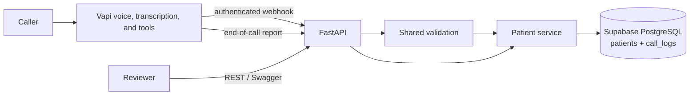

# Care Cloud Patient Intake API

A take-home demonstration of a phone-based patient registration workflow backed by a REST API and persistent PostgreSQL database. The voice assistant collects and reads back demographics, waits for the caller's confirmation, and saves through the same patient service used by the API.

> **Demo and privacy notice:** Use synthetic data only. This project is not a production clinical system and has not been assessed or certified for HIPAA compliance. The patient read endpoints are currently public, and confirmed registration payloads and call transcripts can contain sensitive information. Do not enter real patient data.

## Live demo

- **API base URL:** <https://voice-ai-agent-patient-registration-navy.vercel.app>
- **Patient dashboard:** <https://voice-ai-agent-patient-registration-navy.vercel.app/dashboard>
- **Health:** <https://voice-ai-agent-patient-registration-navy.vercel.app/health>
- **Interactive API docs:** <https://voice-ai-agent-patient-registration-navy.vercel.app/docs>
- **Vapi phone number:** **+1 (386) 293-8129**
- **Repository:** <https://github.com/jameelkhalidawan/Voice-AI-Agent-Patient-Registration-System>
- **Reviewer write key:** Share a temporary or rotated `API_KEY` privately with the reviewer. Never put a real key in this repository, README, issue, or screenshot.

The deployed URL, number, Vapi credentials, and free-tier availability should be checked again on the review day. Service limits and free-tier terms can change.

## What it does

1. A caller chooses new registration or an existing-record update.
2. The assistant gathers the required fields conversationally, validates fields through the backend, and checks an active phone number for a possible duplicate.
3. It reads back the collected details and waits for a clear caller confirmation before invoking a write tool.
4. The webhook revalidates and persists through `PatientService`; it returns success or a caller-safe failure.
5. Vapi's end-of-call report can save a transcript and summary linked to the call and, when available, patient.

For writes, the webhook requires the `caller_confirmation` tool argument to equal `yes`. The backend does **not** independently prove that the caller said yes from a transcript; the voice model is instructed to set the argument only after hearing confirmation. Updates additionally require backend verification of the existing patient's phone number and date of birth.

## Architecture



### Stack and rationale

- **FastAPI + Pydantic settings:** typed request handling, dependency injection, and OpenAPI docs at `/docs`.
- **SQLAlchemy + PostgreSQL:** relational persistence that survives Vercel function restarts and redeployments; SQLite is used for local development and isolated tests.
- **Vapi:** telephony, speech, and tool orchestration configured in its dashboard. The checked-in prompt and tool schemas are in `app/prompts/` and `app/telephony/`.
- **Vercel:** hosts the public API deployment connected to GitHub.
- **Supabase:** hosted PostgreSQL database.

## Repository map

```text
app/
  api/                 REST routes, dashboard, schemas, auth, middleware, errors
  data/                SQLAlchemy models and database session
  prompts/              Versioned voice-agent system prompt
  services/             Shared validation and patient CRUD service
  telephony/            Vapi webhook handler and tool definitions
scripts/                Schema creation and fake seed data
tests/                  API, validation, service, and webhook tests
.env.example            Safe environment-variable template
```

## Local setup (Windows PowerShell)

Use Python 3.12 (or a compatible Python version satisfying the dependency ranges).

```powershell
python -m venv .venv
.venv\Scripts\Activate.ps1
python -m pip install -r requirements.txt
Copy-Item .env.example .env
```

Edit `.env` with a local SQLite URL and development-only random secrets. Do not share `.env` or commit it. The example file uses placeholders.

```env
DATABASE_URL=sqlite:///./care_cloud.db
API_KEY=replace-with-a-long-random-secret
VAPI_WEBHOOK_SECRET=replace-with-a-different-long-random-secret
```

Create the local schema, optionally add two fake seed patients, and start the API:

```powershell
python -m scripts.create_schema
python -m scripts.seed
python -m uvicorn app.main:app --reload
```

Open `http://127.0.0.1:8000/health` and `http://127.0.0.1:8000/docs`.

To run the automated suite against its isolated temporary SQLite databases:

```powershell
python -m pytest -q
```

The tests use isolated temporary SQLite databases and do not touch the hosted database. See the Tests section for the latest result.

## Dashboard

The read-only dashboard is available at `/dashboard`. It fetches the public `GET /patients` endpoint and shows each patient's name, date of birth, masked phone number (last four digits only), city/state, preferred language, and creation time in the viewer's local time. Search filters the loaded rows by name or phone suffix. It omits email, street address, insurance, and emergency-contact fields to minimize exposure, but the underlying patient read API is public, so use fake data only.

## Environment variables

| Variable | Purpose | Example / notes |
|---|---|---|
| `APP_NAME` | FastAPI title | `Care Cloud Patient Intake API` |
| `APP_ENV` | Environment label | `development` or `production` |
| `LOG_LEVEL` | Logging threshold | `INFO` |
| `HOST` | Local Uvicorn bind host | `127.0.0.1` |
| `PORT` | Local server port | `8000` |
| `DATABASE_URL` | SQLAlchemy database URL | SQLite locally; hosted PostgreSQL in production |
| `API_KEY` | Required `X-API-Key` for write routes | Keep secret; share reviewer key privately |
| `VAPI_WEBHOOK_SECRET` | Shared secret for Vapi webhook authentication | Vapi Authorization Bearer token must match |
| `CORS_ORIGINS` | Optional comma-separated browser origins | Empty by default |
| `MAX_REQUEST_BYTES` | Request-body limit for non-webhook routes | Default `65536` |
| `MAX_WEBHOOK_REQUEST_BYTES` | Webhook request-body limit | Default `1048576` |
| `RATE_LIMIT_PER_MINUTE` | In-process per-client request limit | Default `120`; not shared across serverless instances |

## Database

The `patients` table uses a UUID primary key and stores demographics, contact details, optional insurance/emergency-contact fields, timestamps, and `deleted_at`. Active phone numbers are unique. Deletion is a soft delete; normal list/get/find operations exclude deleted rows. `call_logs` stores call status and may store the transcript, summary, and final collected payload.

The schema is created with SQLAlchemy `create_all` using:

```powershell
python -m scripts.create_schema
```

This project does not currently include Alembic migrations. Run schema creation intentionally against the intended database; do not point seed scripts at production unless you mean to insert the documented fake demo rows.

## REST API

All responses use this envelope:

```json
{"data": {}, "error": null}
```

Errors use `{"data": null, "error": {"code": "...", "message": "...", "fields": {}}}`. Write endpoints require `X-API-Key`; read endpoints currently do not.

| Method | Path | Purpose | Success |
|---|---|---|---|
| `GET` | `/health` | Liveness check | `200` |
| `GET` | `/patients` | List active records; optional exact, case-insensitive `last_name`, normalized `date_of_birth`, and normalized `phone_number` filters | `200` |
| `GET` | `/patients/{patient_id}` | Get one active record | `200`; `404` if missing/deleted |
| `POST` | `/patients` | Create a record | `201`; `409` active phone duplicate |
| `PUT` | `/patients/{patient_id}` | Partial update | `200`; `404` missing/deleted |
| `DELETE` | `/patients/{patient_id}` | Soft delete | `200`; row remains in DB |

Validation failures return `422`; malformed requests (including malformed UUID path values) return `400`; invalid write keys return `401`; oversized requests return `413`; rate-limited requests return `429`; unexpected failures return a generic `500` envelope without a client-facing traceback.

### Create example

Use fake data and replace `YOUR_API_KEY` locally. Do not paste a real key into documentation or chat.

```powershell
$headers = @{ "X-API-Key" = "YOUR_API_KEY" }
$body = @{
  first_name = "Casey"
  last_name = "Demo"
  date_of_birth = "1991-06-15"
  sex = "Other"
  phone_number = "2025550186"
  address_line_1 = "42 Test Avenue"
  city = "Sample City"
  state = "Virginia"
  zip_code = "22030"
} | ConvertTo-Json

Invoke-RestMethod -Method Post `
  -Uri "https://voice-ai-agent-patient-registration-navy.vercel.app/patients" `
  -Headers $headers -ContentType "application/json" -Body $body
```

The response includes `data.patient_id`; use that ID for subsequent GET, PUT, or DELETE requests. Swagger UI at `/docs` can also exercise the routes. Do not include real patient information in public calls.

## Voice prompt and tools

- Full system prompt: `app/prompts/registration_system_prompt.md`
- Vapi function schemas: `app/telephony/vapi_tools.json`
- Authenticated webhook route: `POST /webhook/vapi`

The prompt emphasizes a natural one-question-at-a-time flow, accepting out-of-order answers, avoiding repeated questions, validating each field, reading back details, and saving only after a clear affirmative. The backend remains authoritative for validation and persistence. The assistant's live prompt and tool configuration are maintained separately in Vapi; keep them synchronized with the checked-in files.

## Observability

Successful voice registrations log the final collected payload as structured JSON to stdout, which is available in the deployment's function logs. The call status and final payload are also stored in `call_logs`; the end-of-call report can attach a transcript and summary when Vapi sends them.

## Tests

Run all tests locally:

```powershell
python -m pytest -q
```

Fixtures create isolated temporary SQLite databases. They cover API routes, service behavior, validators, Vapi tool confirmation/identity handling, and dashboard response/rendering markers. The most recent reported run was `python -m pytest -q`: **42 passed in 1.68 seconds**.

## Deploying

1. Connect the GitHub repository to the Vercel project and deploy the intended branch. Add `DATABASE_URL`, `API_KEY`, `VAPI_WEBHOOK_SECRET`, `APP_ENV`, and `LOG_LEVEL` in Vercel's environment settings; keep secret values out of Git.
2. With `DATABASE_URL` set locally to the intended Supabase PostgreSQL connection string, create the tables once by running `python -m scripts.create_schema` from the repository root. This uses SQLAlchemy `create_all`; it is not a versioned migration system.
3. Set Vapi's server URL to `https://voice-ai-agent-patient-registration-navy.vercel.app/webhook/vapi` and configure its Bearer credential with the same secret value as Vercel's `VAPI_WEBHOOK_SECRET`.
4. After deployment, verify `/health`, `/docs`, and one synthetic end-to-end call. The Vapi dashboard prompt, tool definitions, credential, and phone-number assignment are configured separately from the repository.

## Edge cases exercised

**API (manual):** I verified successful create/read/update, all three filters, soft-delete exclusion, duplicate phone rejection (409), invalid write-key rejection (401), malformed IDs and JSON (400), invalid phone/DOB/state/ZIP/name/sex/email input (422), missing required fields, and rejection of SQL-style and script-like input.

**Voice (manual calls):** I tested new-patient registration, returning-caller lookup with the update declined, surname correction after read-back, out-of-order answers, correction of a short phone number, and an emergency statement.

**Not yet tested by phone:** silence/timeout handling, start-over, hang-up before confirmation, prompt-injection attempts, and a simulated database-write failure.

## Bonus features

- **Present:** duplicate-phone lookup and returning-caller identity verification; end-of-call transcript/summary storage when Vapi supplies the report; automated tests; read-only patient dashboard.
- **Not implemented:** appointment scheduling and a public endpoint for viewing call transcripts. Spanish responses are prompt-guided but are not a fully tested localization feature.

## Known limitations and trade-offs

- **Public reads:** `GET /patients` and `GET /patients/{id}` do not require authentication. Deployment is for fake/demo data only; this needs access control before any real patient information could be considered.
- **Dashboard access:** the dashboard reads the same public patient API. It masks phone numbers and omits more sensitive columns in its UI, but this is not access control for the underlying data.
- **Confirmation:** the backend trusts the `caller_confirmation: "yes"` tool argument and does not independently match it to the audio/transcript. The prompt tells the agent to set it only after the caller says yes.
- **Vapi configuration:** prompt, tool schemas, phone-number assignment, speech provider, and webhook credential are dashboard settings and must be checked against the repo and deployment.
- **Migrations:** schema creation uses `create_all`; there is no Alembic history or automated deployment migration.
- **Rate limiting:** the simple middleware keeps counters in process memory, so it is not a global limit across serverless instances.
- **Voice and free-tier availability:** latency, transcription quality, number availability, trial credits, and provider free limits can change; verify balances and current provider terms before review.
- **Call logs:** transcripts may contain personal details; only fake/test calls should be used for this assignment demo.
- **Cold starts/availability:** the deployment host may sleep or impose execution limits depending on current plan settings; verify availability shortly before the review call.

## Next steps

1. Add access control to patient read endpoints before any non-demo use.
2. Add Alembic migrations and deployment-safe migration instructions.
3. Add integration tests for webhook event payloads and failure cases.
4. Add authenticated call-log retrieval if transcript review is needed.
5. Consider appointment scheduling and full Spanish localization only after the core registration flow is stable.

## AI assistance

AI coding assistants were used during development; I ran the test suite and can explain the implementation and its trade-offs.

